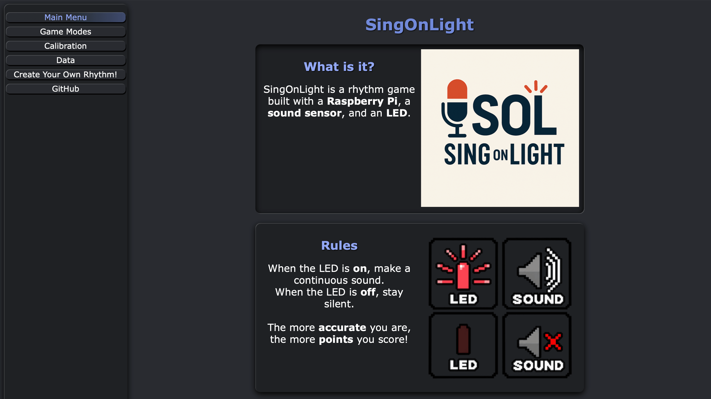

# SingOnLight


A rhythm game where players reproduce light sequences using their voice.



## Overview

SingOnLight is a web-based rhythm game built with Python, FastAPI, SQLite, and a Raspberry Pi with Grove components.

The project was originally developed as a first-year university group project. The original repository can be found [here](https://github.com/Bigouz/SingOnLight). I later continued it individually, reorganizing and refactoring the codebase, translating the application and documentation into English, and adding a simulation mode to run the game without Raspberry Pi hardware.

## Features

- Single-player, story, and two-player game modes.
- Custom rhythm creation.
- Manual and automatic sound-threshold calibration.
- Sound detection and rhythm scoring.
- Persistent game settings and scores stored in SQLite.
- A chart showing the distribution of game scores.
- Real-time status messages over WebSockets.
- Hardware-free simulation mode for trying the application locally.

## Requirements

### Software

- Python 3.10 or newer.
- The Python packages listed in `requirements.txt`.

### Hardware

To play with the physical setup, you will need:

- A Raspberry Pi.
- A Grove Base Hat.
- A Grove sound sensor connected to analog input A0.
- A Grove red LED connected to port 12.

The Grove library providing `grove.adc` and `grove.gpio` must be installed separately on the Raspberry Pi according to the manufacturer's instructions. It is not included in `requirements.txt`.

## Setup

Clone the repository and install the Python dependencies in a virtual environment:

```bash
git clone https://github.com/Matteolsj/SingOnLight.git
cd SingOnLight
python3 -m venv venv
source venv/bin/activate
python -m pip install --upgrade pip
python -m pip install -r requirements.txt
```

On Windows PowerShell, activate the environment with:

```powershell
venv\Scripts\Activate.ps1
```

In Command Prompt, use `venv\Scripts\activate.bat` instead.

## Run

### Simulation Mode

You can run the application without a Raspberry Pi:

```bash
python main.py
```

This launches simulation mode and opens [http://127.0.0.1:8001](http://127.0.0.1:8001) in your browser.

In simulation mode, the sensor produces readings that match the expected rhythm, the LED operations are skipped, and automatic calibration uses a fixed threshold. With the default threshold, games return a perfect score. Simulation is useful for exploring the pages and game flows, but it does not test real sensor behavior.

### Raspberry Pi Mode

Install the Grove library and connect the sensor and LED as described above. Then start the application from the project root with the virtual environment activated:

```bash
python -m singonlight.main
```

This launches hardware mode and opens [http://127.0.0.1:8001](http://127.0.0.1:8001) in your browser. The `singonlight.db` SQLite database is created and initialized automatically on first launch. You can also start the server without automatic browser opening with `python -m uvicorn singonlight.main:app --reload --port 8001`.

## How to Play

1. Choose a game mode.
2. Follow the LED in real time: make a continuous sound while it is on and stay silent while it is off.
3. Review your score or continue through the story mode.

The game compares the sound detected during the light sequence with the expected rhythm and calculates a score.

## How It Works

- FastAPI serves the web pages and handles game actions.
- Jinja2 renders the HTML templates.
- The Grove sound sensor provides analog sound readings while the LED plays the rhythm.
- The calibration threshold determines whether a reading counts as a sound.
- The scoring service compares the detected rhythm with the expected sequence.
- SQLite stores game settings, custom rhythms, story levels, and scores.
- WebSockets deliver real-time status messages to the browser.
- Simulation mode substitutes generated readings for the physical sensor and skips LED output.

## Project Structure

- `.github/assets/`: README images
  - `demo.png`: homepage screenshot
- `singonlight/`: main application package
  - `main.py`: FastAPI application setup and startup
  - `database.py`: SQLite schema and initial data
  - `settings.py`: shared paths and simulation setting
  - `devices/`: hardware access and simulation behavior
    - `led.py`: Grove LED control
    - `sound_sensor.py`: Grove sound sensor and simulated readings
  - `realtime/`: real-time communication
    - `websocket_manager.py`: WebSocket connections and broadcasts
  - `routes/`: application pages and endpoints
    - `calibration.py`: calibration pages and endpoints
    - `gameplay.py`: game and custom-rhythm endpoints
    - `pages.py`: main page routes
  - `services/`: game rules and calculations
    - `game_service.py`: game settings, rhythms, and score persistence
    - `scoring.py`: rhythm score calculation
  - `static/`: browser assets
    - `css/`: stylesheets
    - `images/`: game images and icons
    - `js/`: browser-side game logic
  - `templates/`: Jinja2 HTML templates
- `tools/`: development utilities
  - `calibration_simulator.py`: optional calibration simulation helper
- `main.py`: launches the application in simulation mode
- `requirements.txt`: Python dependencies
- `README.md`: project documentation

## Development notes

- The local singonlight.db database is created automatically when the application starts.
- The database contains local game data and is not shared between installations.
- The application uses port 8001 by default in the documented run commands.

## Credits

Grove component documentation:
- [Grove Sound Sensor](https://wiki.seeedstudio.com/Grove-Sound_Sensor/)
- [Grove Red LED](https://wiki.seeedstudio.com/Grove-Red_LED/)

## Contributors

[](https://github.com/Matteolsj)
[](https://github.com/Bigouz)
[](https://github.com/AaronWrobel001)
[](https://github.com/Sedique1)

These profiles contributed to the [original group project](https://github.com/Bigouz/SingOnLight).
